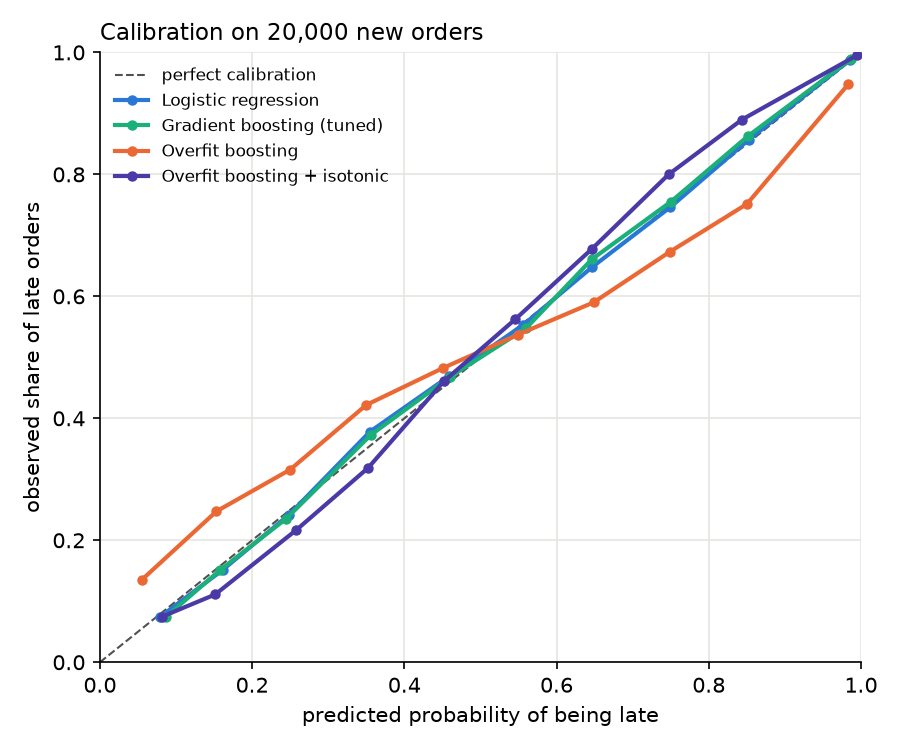
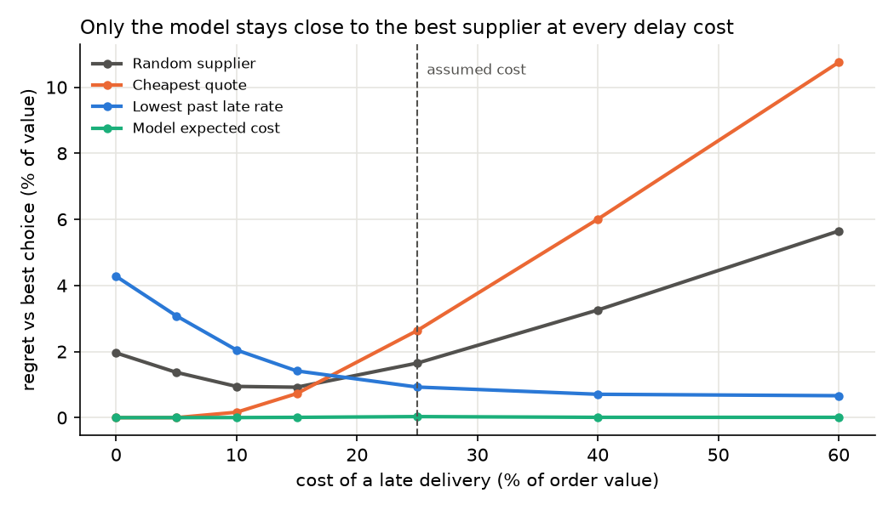

# ProcureML: from late-delivery prediction to supplier decisions

Buyers make two decisions on every order: *will it arrive late?* and *who should
supply it?* This project builds a late-delivery classifier and a supplier recommender,
and evaluates both against the **ground truth**, which is possible because the data
comes from a simulator that knows every supplier's real reliability.

It is the second of three linked projects:
**P1 [SynthSupply](../synth-supply)** (synthetic data) → **P2 ProcureML** (prediction and
recommendation) → **P3** (serving, orchestration and drift monitoring).

## 1. The procurement world

`scripts/make_data.py` uses P1's domain simulator, calibrated on the DataCo dataset,
to generate:

| Table | Rows | What it holds |
|---|---|---|
| `history.csv` | 80,000 | past orders with known outcomes: what models learn from |
| `new_orders.csv` | 20,000 | new orders to predict and source |
| `suppliers.csv` | 33 | 3 suppliers per department, each with a price premium |

**The buyer's trade-off:** reliable suppliers charge more. Premiums range from −1.6% to
+11.7% and correlate at −0.94 with true risk. A late delivery is assumed to cost **25% of
the order value** (stoppage, expediting); section 4 tests other values.

**Hidden truth.** Columns prefixed `true_` (and `sim.late_probability()`, added to P1 for
this project) give the exact probability of delay of any order with any supplier. Models
never see them; they are used only for grading.

## 2. Predicting late deliveries

Features are only what is known at order time (supplier, market, month, shipping mode,
department, quantity, price, ...). Trained on the history, scored on new orders.

| Model | AUC | Brier | Calibration error | Error vs truth | Prediction time |
|---|---|---|---|---|---|
| Historical late rate of the shipping mode | 0.732 | 0.191 | | | negligible |
| **Logistic regression** | **0.833** | **0.164** | **0.007** | **0.011** | **1×** |
| Gradient boosting (defaults) | 0.831 | 0.165 | | | ~2× |
| Gradient boosting (tuned, successive halving) | 0.833 | 0.164 | 0.009 | 0.013 | ~5× |
| Overfit gradient boosting | 0.809 | 0.179 | 0.056 | 0.086 | ~6× |
| Overfit + isotonic calibration | 0.817 | 0.172 | 0.024 | 0.067 | ~20× |
| *True probabilities (ceiling)* | *0.833* | *0.164* | *0.007* | *0* | |

Prediction time is relative to the logistic regression (about 1 to 2 µs per order on a laptop); exact values are in `results/`.

1. **Both models reach the ceiling.** The logistic regression is within 0.0005 AUC of the
   true probabilities: nothing is left to learn.
2. **The simple model wins.** Delay risk in this world is additive (supplier + market +
   season), which is exactly what a logistic regression models. Tuning the boosted model
   with successive halving (48 candidates, 72 fits) only matches it. The logistic
   regression is also the best calibrated and about 5× faster at prediction, so it is the
   model used for recommendation and the one P3 will serve.
3. **Overfitting breaks probabilities; calibration only partly repairs them.** The overfit
   model is over-confident (it says 85% where 75% happen). Isotonic calibration halves the
   calibration error but cannot recover the lost ranking, and triples latency.
4. **The model found the true causes.** Permutation importance ranks shipping mode,
   supplier, market and month first; every other input is close to zero.



## 3. Recommending suppliers

For each new order, the three suppliers of its department are scored by

    expected cost = value × (1 + premium) + 25% × value × P(late | supplier)

with P(late) from the logistic regression, and the cheapest in expectation is chosen.
Every choice is graded with the **true** probabilities against the best possible choice.

| Strategy | Hit@1 | NDCG | True late rate | Regret (% of value) |
|---|---|---|---|---|
| Random supplier | 0.331 | 0.810 | 57.6% | 1.65 |
| Cheapest quote | 0.257 | 0.755 | 69.6% | 2.63 |
| Lowest past late rate | 0.528 | 0.875 | **45.3%** | 0.93 |
| **Model expected cost** | **0.903** | **0.986** | 48.6% | **0.03** |

1. **The model picks the best supplier in 90% of orders** and ends within 0.03% of the
   optimal cost.
2. **Minimising delays is not minimising cost.** Always choosing the most reliable
   supplier gives fewer delays (45.3% vs 48.6%) but costs more, because it pays the
   reliability premium even where a delay is cheap.
3. **Always choosing the cheapest quote is worse than choosing at random:** the cheapest
   suppliers are the least reliable.

## 4. Is the conclusion robust to the cost of a delay?

The 25% penalty is an assumption, so every strategy was re-run for penalties from 0% to 60%.



The model's regret stays close to zero at every penalty. The rule-based strategies each
work only at one extreme: the cheapest quote when delays cost nothing, the most reliable
supplier when they cost a lot. Combining price and calibrated risk is what makes the
decision robust.

## 5. Run it

P1 must sit next to this folder (`../synth-supply`) with its dataset downloaded.

```bash
uv venv --python 3.12 && source .venv/bin/activate
uv pip install -r requirements.txt          # installs ../synth-supply in editable mode

python scripts/make_data.py                 # the procurement world      -> data/
python scripts/train_classifier.py          # classifiers + importance   -> results/
python scripts/tune_and_calibrate.py        # tuning + calibration (~1 min)
python scripts/recommend_suppliers.py       # recommendation + sensitivity
```

Everything is seeded and library versions are pinned in `requirements.txt`.

## 6. Limitations and next steps

* The world is synthetic: the model reaches the ceiling partly because the simulator's
  risk is additive. Real delays will have interactions and drift, which is where boosting
  and monitoring (P3) earn their place.
* The supplier price model and the 25% penalty are assumptions; section 4 bounds the
  second one.
* Supplier choice is made one order at a time. Capacity limits, minimum volumes or
  contracts would turn it into an optimisation problem (e.g. an integer program).
* Natural extensions: demand forecasting and reorder points with safety stock driven by
  the predicted lead-time uncertainty.

## Layout

```
src/procureml/data.py          build and load the procurement world
src/procureml/classify.py      features, models, scores
src/procureml/recommend.py     candidates, expected cost, Hit@1, NDCG, regret
scripts/make_data.py           step 1
scripts/train_classifier.py    step 2
scripts/tune_and_calibrate.py  step 3
scripts/recommend_suppliers.py step 4
results/                       tables and figures
```
